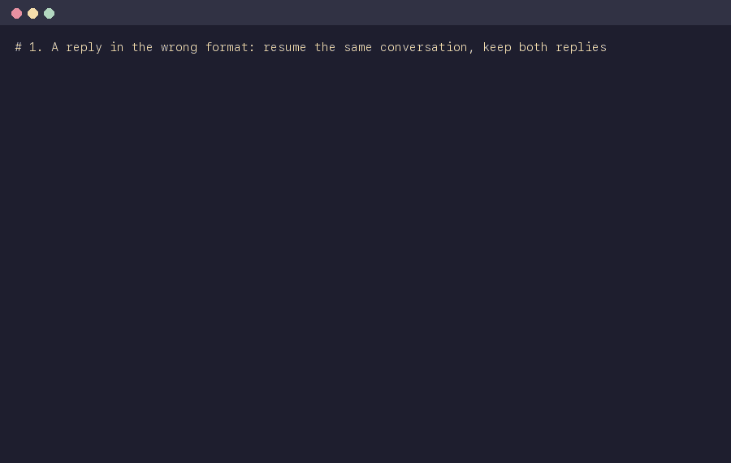

# agy-call



## What it does

Claude Code can hand work to Google's Gemini through the `agy` CLI (Antigravity): a coding task, a review, a question, or a batch of tasks.
This repository is the Claude Code plugin `agy` and the command-line runner `agy-call` behind it.
Calling `agy` directly caused two problems.
When a reply came back in the wrong format, it was thrown away and the question was asked again in a new conversation, so the paid-for answer was lost.
When one task ran out of Gemini quota, the other tasks running at the same time did not find out and kept sending requests that could not succeed.

agy-call sits between Claude and Gemini and handles both:

- It saves every reply to disk before checking it, so no paid reply is lost.
- When a reply is unusable, it goes back to the same conversation and tells Gemini what to fix, instead of starting over.
- When one call hits the quota limit, it records a hold for the whole machine; every other call checks the hold before launching and waits until the limit resets.
- It can check answers for you, for example requiring valid JSON with certain fields, and sends a reply back when the format is wrong.
- A call can run in the background; `agy-call status`, `result` and `cancel` show how it is going, print its answer and stop it.
- It can hand a coding task to Gemini in its own git worktree and branch, with a permission grant made for that task only, and merge the checked result locally.
- It can have Gemini review the current change in a read-only snapshot and return a checked list of findings, each with a severity, tied to the exact code reviewed.

Claude uses Gemini only when you ask for it, by a slash command or in plain words.
The guard hook stops Claude from calling `agy` directly, so every call goes through agy-call.

## Commands

| Slash command | What it does |
|---|---|
| `/agy:task [--background] [--continue JOB] [--model M] [--effort E] <task text>` | Hands a coding task to Gemini in its own worktree on branch `agy/<job>`; Claude picks the build and test commands Gemini may run, then checks, commits and merges the result locally and never pushes. |
| `/agy:review [--background] [--scope auto\|working-tree\|branch] [--base REF]` | Gemini reviews the current change and returns findings marked MUST-FIX, SHOULD-FIX or NIT. |
| `/agy:adversarial-review [--background] [--scope ...] [--base REF] [focus text]` | The same review, told to assume the change has defects and to challenge its design. |
| `/agy:status [JOB] [--all]` | Lists the jobs of this repository, or shows one job in full. |
| `/agy:result [JOB]` | Prints a job's outcome: a task's hand-back or a review's findings. |
| `/agy:cancel [JOB]` | Stops a queued or running job and keeps what it produced. |
| `/agy:setup` | Checks Python, the operating system, agy's version, flags and sign-in, and the model names, without spending quota. |

The commands use the model `gemini-4-argon-high`, and reviews `--effort high`, unless you name others.
Claude never starts a fix or a second review by itself after a review; that follows your own instructions.
`skills/agy-call/SKILL.md` documents every `agy-call` command and option, including `run` and `batch` for questions and scripts.

## What a task's permission grant does and does not do

Each task gets its own permission grant, passed to agy with `--settings`, so you never edit agy's own settings to let a task run.
The grant lets agy's file-writing tool write only inside the task's worktree, and lets Gemini run a fixed set of read-only commands (`ls`, `cat`, `head`, `tail`, `wc`, `grep`, `rg`, `git status`, `git diff`, `git log`, `git show`) plus the build and test commands Claude chose for that task.
A review's grant has the read-only commands only.
The grant also turns off agy's access outside the workspace (`allowNonWorkspaceAccess: false`), because agy otherwise follows the global `allowNonWorkspaceAccess` setting, which a per-job `--settings` file does not replace.
agy adds the Antigravity app's shared grants (`userSettings.globalPermissionGrants.allow` in `~/.gemini/config/config.json`) to every run that uses `--settings`, so agy-call lists each shared grant that is not one of the task's own entries in the grant's `deny` list, and agy refuses those for the task.
agy-call cannot limit what a granted command does: a test command runs the repository's own code, which can do anything your account can, and git commands follow the repository's own configuration.
agy's `--sandbox` flag did not stop a granted command from writing outside the workspace when measured, so agy-call does not use it.
Measured on agy 1.5.6: a write outside the granted folder was refused, a shared grant listed in `deny` was refused, and a resumed conversation used only its own run's grant.

## Install

Requirements: the `agy` CLI 1.5.6 or newer, installed and signed in; Python 3.9 or newer (standard library only); macOS or Linux.
agy-call finds agy on the PATH or through `AGYCALL_AGY`.
The Antigravity plugin is no longer needed: agy-call launches agy itself.

### As a Claude Code plugin

In Claude Code 2.1.275 or later:

```
/plugin install agy --marketplace shitanshuuppal/agy-call
```

In older versions:

```
/plugin marketplace add shitanshuuppal/agy-call
/plugin install agy@agy-call
```

Restart Claude Code afterwards, then run `/agy:setup` to check the installation.
The plugin installs the slash commands, the `agy` subagent and the skill, puts the `agy-call` command on the PATH inside Claude Code sessions, and turns on two hooks: the guard hook, which refuses Bash commands that call agy directly, and a session hook that lets agy-call tell which Claude session started each job.

### Moving from agy-call 0.1

The plugin was called `agy-call` up to version 0.1.0 and is called `agy` from 0.2.0; the marketplace keeps the name `agy-call`.
Uninstall the old plugin once, then install the new one as above:

```
/plugin uninstall agy-call@agy-call
```

If you installed by hand with symlinks, remove the skill and hook symlinks before installing the plugin, so the skill and the guard hook are not loaded twice:

```sh
rm ~/.claude/skills/agy-call/SKILL.md ~/.claude/hooks/agy_guard.py
rmdir ~/.claude/skills/agy-call
```

Also remove the guard hook's entry from `hooks.PreToolUse` in `~/.claude/settings.json`.
If you keep the `~/.local/bin/agy-call` link for use outside Claude Code, update your clone (`git pull`) so it runs the same version as the plugin.
`AGY_DELEGATE` and `AGYCALL_REAL_AGY` are no longer read; set `AGYCALL_AGY` if agy is not on the PATH.
The release notes (`docs/release-notes-0.2.0.md` and `docs/release-notes-0.2.1.md`) list every change.

### Manual install

Use this if you want `agy-call` on the PATH outside Claude Code without the plugin.
The steps assume the repo is cloned to `~/Code/agy-call`; use your own path if it differs.

```sh
git clone https://github.com/shitanshuuppal/agy-call.git ~/Code/agy-call
mkdir -p ~/.claude/skills/agy-call ~/.local/bin ~/.claude/hooks
ln -s ~/Code/agy-call/skills/agy-call/SKILL.md ~/.claude/skills/agy-call/SKILL.md
ln -s ~/Code/agy-call/bin/agy-call ~/.local/bin/agy-call
ln -s ~/Code/agy-call/hooks/agy_guard.py ~/.claude/hooks/agy_guard.py
```

`~/.local/bin` must be on the PATH; check with `agy-call setup`.
The slash commands and the session hook come with the plugin only.

The guard hook is optional but recommended.
To enable it, add this entry under `hooks.PreToolUse` in `~/.claude/settings.json`, with your own absolute home path:

```json
{
  "matcher": "Bash",
  "hooks": [
    {"type": "command", "command": "python3 /Users/<you>/.claude/hooks/agy_guard.py", "timeout": 5}
  ]
}
```

Restart Claude Code so it loads the skill and the hook.
Scripts can import the package with `sys.path.insert(0, os.path.expanduser("~/Code/agy-call"))`.

## Details

agy-call is standard-library Python.
Run the tests with `uvx pytest -q tests/`; they use a stand-in for agy and spend no Gemini quota.
`skills/agy-call/SKILL.md` is the user guide.
`docs/demo/` regenerates the demo GIF with the test suite's stand-in for agy, so it spends no Gemini quota.
